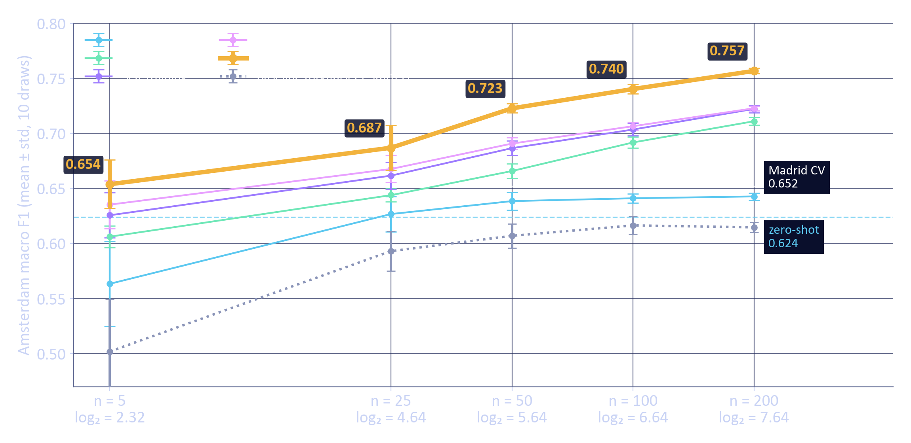
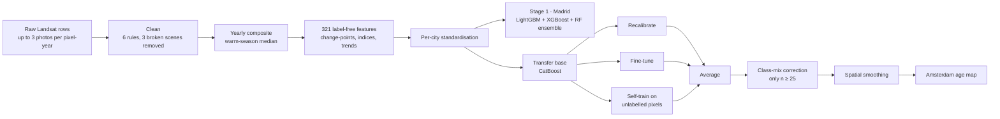
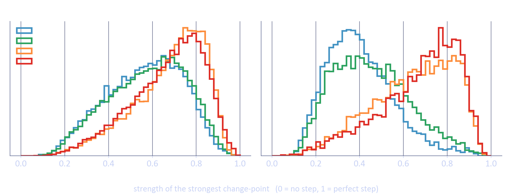
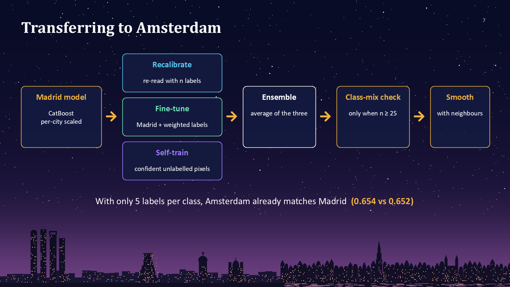
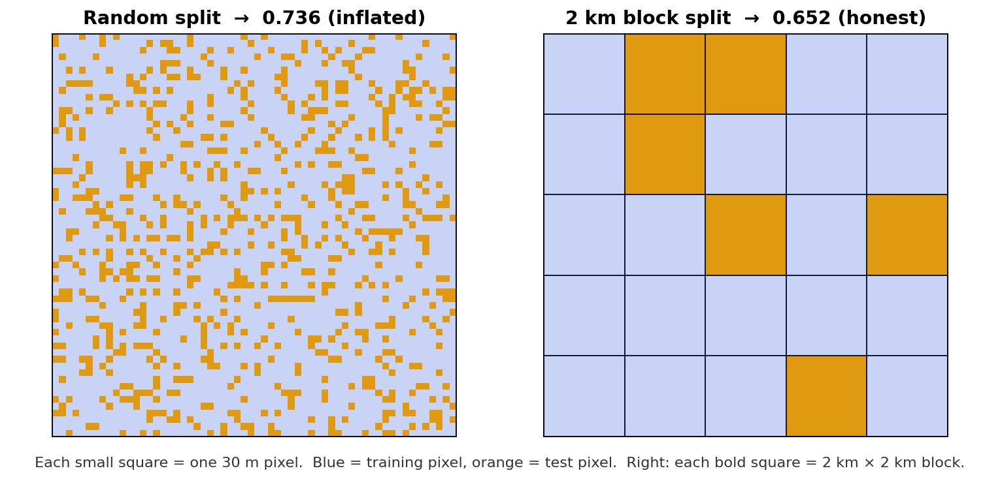
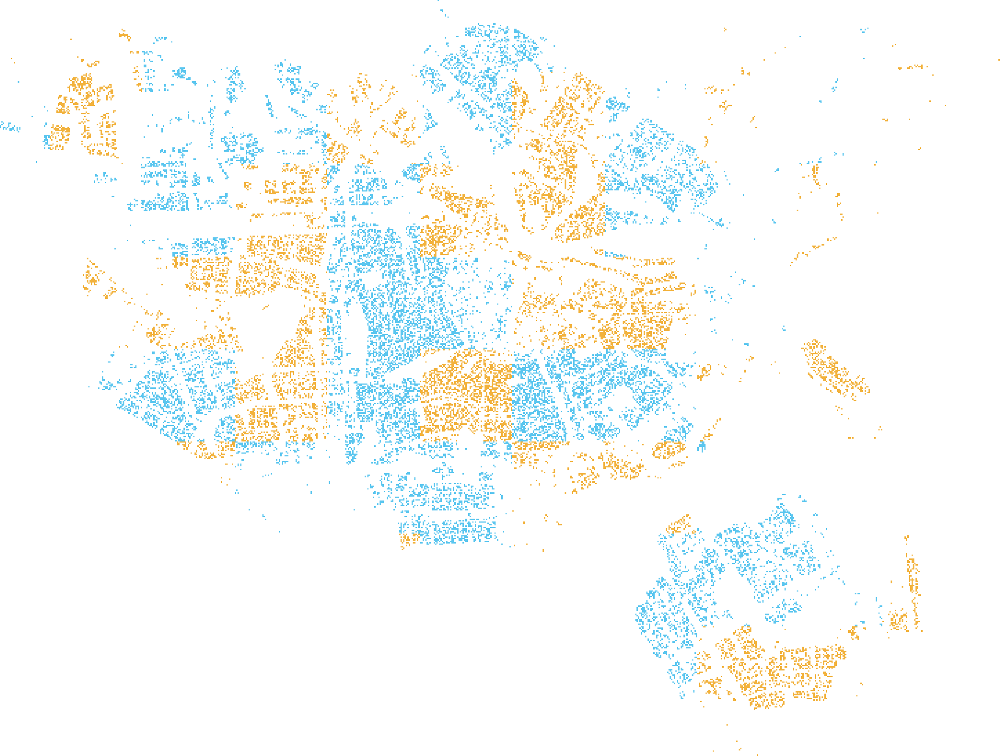
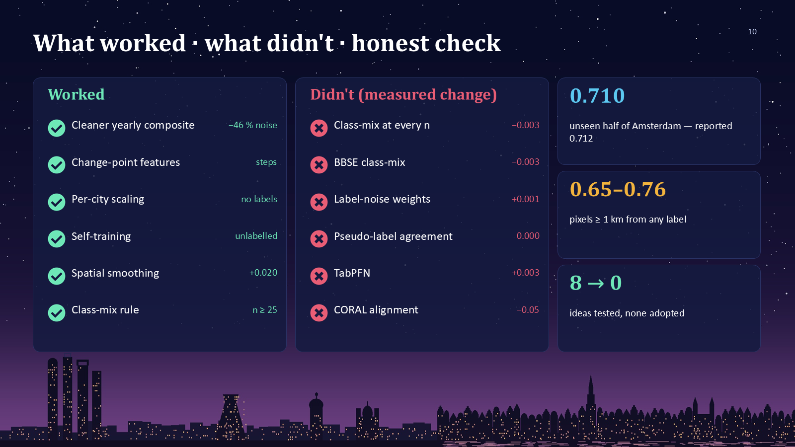

# Dating Cities from Space 🛰️🏙️

**Building-age classification from 42 years of Landsat imagery: trained on Madrid, transferred to Amsterdam with as few as 5 labels per class.**

🏆 **1st Place Overall** · **Best Average F1** · **Best Peak F1** · **Best Originality**
*ZAS 2026 Data Science Regional Hackathon, 5–8 October 2026, hosted at ZINGSA, Zimbabwe.*


---

## Contents
1. [The challenge](#1-the-challenge)
2. [Results at a glance](#2-results-at-a-glance)
3. [How it works (pipeline)](#3-how-it-works)
4. [Step 1: understanding and cleaning the data](#4-step-1-understanding-and-cleaning-the-data)
5. [Step 2: features that describe change, not brightness](#5-step-2-features-that-describe-change-not-brightness)
6. [Step 3: the Madrid model (Stage 1)](#6-step-3-the-madrid-model-stage-1)
7. [Step 4: transferring to Amsterdam (Stage 2)](#7-step-4-transferring-to-amsterdam-stage-2)
8. [Honest validation](#8-honest-validation)
9. [What worked and what didn't](#9-what-worked-and-what-didnt)
10. [Why does Amsterdam score higher than Madrid?](#10-why-does-amsterdam-score-higher-than-madrid)
11. [Repository structure](#11-repository-structure)
12. [How to run](#12-how-to-run)
13. [Team and acknowledgements](#13-team-and-acknowledgements)

---

## 1. The challenge

Every 30 m × 30 m square (pixel) of a city has been photographed by the Landsat satellites every year since 1984. The task is to predict the **age class** of the buildings in each pixel from that 42-year history:

| Class | Madrid | Amsterdam |
|---|---|---|
| 1 (oldest) | built up to 1960 | built up to 1945 |
| 2 | 1961 – 1984 | 1946 – 1984 |
| 3 | 1985 – 2004 | 1985 – 2004 |
| 4 (newest) | after 2004 | after 2004 |

- **Stage 1:** learn in **Madrid** (76,263 labelled pixels).
- **Stage 2:** move the model to **Amsterdam** (25,992 pixels) when only **n = 5, 25, 50, 100 or 200 labelled pixels per class** are available.
- **Metric:** macro F1, so each of the four classes counts equally.

Classes 1 and 2 were built *before* the satellite record starts, so the images never show them being built. That makes the 1/2 split the hardest part of the problem.

---

## 2. Results at a glance

Every number below is a mean over identical folds or draws for both methods. The **baseline** is the organisers' starter solution (first clear photo per year, 60 features, Random Forest, prototype transfer), re-run by us on the same splits.

| Setting (macro F1) | Starter baseline | **Ours** | Gain | Unseen half of Amsterdam\* |
|---|---|---|---|---|
| Madrid, spatial-block 5-fold CV | 0.574 ± 0.030 | **0.652 ± 0.026** | +0.078 | — |
| Madrid, random 5-fold CV | 0.618 ± 0.005 | 0.736 ± 0.003 | +0.118 | — |
| Amsterdam, no labels (zero-shot) | 0.334 | **0.624** | +0.290 | — |
| Amsterdam, n = 5 per class | 0.502 ± 0.047 | **0.654 ± 0.021** | +0.152 | 0.652 ± 0.031 |
| Amsterdam, n = 25 per class | 0.593 ± 0.018 | **0.687 ± 0.019** | +0.094 | 0.705 ± 0.008 |
| Amsterdam, n = 50 per class | 0.607 ± 0.011 | **0.723 ± 0.004** | +0.116 | 0.717 ± 0.011 |
| Amsterdam, n = 100 per class | 0.617 ± 0.008 | **0.740 ± 0.004** | +0.123 | 0.729 ± 0.008 |
| Amsterdam, n = 200 per class | 0.615 ± 0.004 | **0.757 ± 0.002** | +0.142 | 0.748 ± 0.004 |
| **Amsterdam, average** | 0.587 | **0.712** | +0.125 | **0.710** |

\* A stricter check run after the method was frozen: labels taken only from one half of Amsterdam (2 km blocks), scores measured only on the other half. See [§8](#8-honest-validation).



**Key takeaways**
- With only **5 labels per class (20 pixels)**, Amsterdam already matches our Madrid score (0.654 vs 0.652).
- The starter flattens at about 0.61. Our method keeps improving as labels are added and stays ahead at every sample size.
- On districts the labels never touched, the average is **0.710**, the same as the reported 0.712.

---

## 3. How it works



---

## 4. Step 1: understanding and cleaning the data

Notebook: [`notebooks/00_Data_Audit.ipynb`](notebooks/00_Data_Audit.ipynb)

Our audit of all 48 columns changed the pipeline in several ways:

| Finding | What we did |
|---|---|
| **3 whole satellite scenes are broken** (washed out by haze, fog or snow) but still pass the quality flag | Detected automatically (scene median Blue > 12,000 or > 5 % of pixels > 15,000, using no labels) and removed |
| Photos come from **every season**: only about 31 % of Amsterdam photos are summer images | One value per pixel-year = **median of clean May–September photos**, with other months only as a fallback |
| The starter keeps only the **first clean photo** of each year, ignoring about 60 % of clean photos | Use all clean photos (median) |
| Saturated values, zeros and cirrus contamination | Removed |
| **87 % of neighbouring pixels share the same age class** | Use spatial-block validation (§8) and spatial smoothing (§7) |

The result: **year-to-year noise drops by 40–46 %** compared with the starter's input.

---

## 5. Step 2: features that describe change, not brightness

Notebook: [`notebooks/01_Feature_Engineering.ipynb`](notebooks/01_Feature_Engineering.ipynb)

Building a house is a physical event: vegetation → bare soil → new roof. That leaves a **step** in the pixel's 42-year history. Old buildings (classes 1–2) show flat histories, while new ones (classes 3–4) show strong steps:



We compute **321 features without using any labels**, identically for both cities and for any new pixel:

| Group | # | Content |
|---|---|---|
| S | 58 | Means and standard deviations of 6 bands and 5 indices; early (≤ 2003) vs late (≥ 2004); year-on-year change |
| A | 20 | NBR, NDTI, tasselled-cap brightness, greenness and wetness |
| B | 88 | Robust median, IQR, percentiles, slopes and volatility |
| C | 35 | Medians of 6-year windows |
| D | 36 | **One-break change-point**: year, size and strength of the main jump; biggest single-year jump |
| E | 23 | Relative features: late − early, ratios, band shape |
| F | 5 | Coverage, missing years, photos per year |
| H | 22 | **Two-break change-point** and steepest vegetation → built transition |
| G | 34 | Spatial context: leave-self-out neighbourhood means at 90, 210 and 450 m, building density |

**Per-city standardisation:** each feature is converted to a z-score **within its own city**, so Amsterdam (darker, greener) isn't judged by Madrid's standards. This was the largest label-free transfer gain we found.

Two feature sets are used:
- **RICH** (top 120 features by LightGBM gain) for Madrid.
- **TRANSFER** (140 city-independent features: change-points, starter-style statistics, robust index statistics, no spatial features) for anything that crosses cities.

---

## 6. Step 3: the Madrid model (Stage 1)

| Model (Madrid, spatial-block CV) | Macro F1 |
|---|---|
| Starter baseline (Random Forest on starter features) | 0.574 |
| Logistic Regression | 0.603 |
| MLP (GPU) | 0.628 |
| CatBoost | 0.631 |
| Random Forest | 0.634 |
| XGBoost | 0.646 |
| LightGBM | 0.649 |
| **Ensemble: LightGBM + XGBoost + Random Forest** | **0.652** |

- Even the simplest model beats the baseline, so most of the gain comes from **cleaner data and better features**.
- Training weights = pixel coverage × balanced class weight.
- **CatBoost** is mid-table in Madrid but **travels best to a new city with no labels** (0.593 zero-shot, against 0.334 for the starter), so it is the base of the Amsterdam model.

---

## 7. Step 4: transferring to Amsterdam (Stage 2)

Function: `build_stage2(n, seed)` in [`notebooks/Group2_Submission.ipynb`](notebooks/Group2_Submission.ipynb)



From the CatBoost base and the `n` labelled pixels per class (the *support set*):
1. **Recalibration:** logistic regression re-maps CatBoost's log-probabilities using the support set.
2. **Fine-tuning:** LightGBM retrained on all of Madrid plus the support pixels, which carry 25 % of the total weight.
3. **Self-training:** the 500 most confident **unlabelled** Amsterdam pixels per class become pseudo-labels for a small LightGBM. Only satellite measurements are used, never answers.
4. **Ensemble:** the three are averaged.
5. **Class-mix correction (EM)**, **only when n ≥ 25**. With fewer labels the estimate is unreliable and hurts (tested twice).
6. **Spatial smoothing:** each pixel's probabilities are blended 50/50 with its 5 × 5 neighbourhood. The setting was tuned on **Madrid out-of-fold predictions only**.

---

## 8. Honest validation



**Spatial-block cross-validation.** Neighbouring pixels are near-copies of each other, so a random split lets the model "copy" from the pixel next door and inflates the score (0.736 in Madrid). We hold out whole **2 km × 2 km blocks** (67 × 67 pixels), which gives the honest **0.652**.

**10 draws per sample size.** For each n, the support pixels are drawn at random 10 times (seeds 0–9). We report the mean ± std, and the baseline uses the **same draws**.

**Pre-registered final check** (notebook [`03_Honest_Improvements.ipynb`](notebooks/03_Honest_Improvements.ipynb)). To rule out selection bias from tuning on reported draws:
- Amsterdam was split by 2 km blocks into **DEV** (for decisions) and **TEST** (untouched).
- Eight candidate improvements were judged on DEV only, with new seeds (100–109), against an adoption rule written **before** running: the gain must exceed 2 standard errors, and pixels ≥ 1 km from any label must not get worse.
- The final model was then scored **once** on TEST, with labels from DEV and scores from TEST.
- Everything was run on two machines (CPU and RTX 4060 GPU).



| | n = 5 | 25 | 50 | 100 | 200 | Average |
|---|---|---|---|---|---|---|
| Unseen half (TEST) | 0.652 | 0.705 | 0.717 | 0.729 | 0.748 | **0.710** |
| Pixels ≥ 1 km from any label | 0.648 | 0.703 | 0.717 | 0.731 | 0.760 | 0.712 |
| Official protocol | 0.654 | 0.687 | 0.723 | 0.740 | 0.757 | **0.712** |

**None of the eight ideas passed the rule, so the submitted model is unchanged.** One idea passed DEV by the narrowest margin on one machine, failed on the other, and gave nothing on TEST (−0.0007). That is exactly the false positive a held-out set exists to catch.

Reproducibility: fixed seeds (42 for models, 0–9 for draws). CPU and GPU runs agree within ±0.003. The full pipeline takes about 18 minutes on an RTX 4060 laptop GPU and about 60 minutes on 8 CPU threads.

---

## 9. What worked and what didn't



| ✅ Worked | ❌ Didn't (measured change in macro F1) |
|---|---|
| Cleaner yearly composite (noise −46 %) | Class-mix correction at every n (−0.003; hurts n = 5) |
| One- and two-break change-point features | BBSE class-mix estimate (−0.003) |
| Per-city standardisation | Label-noise weights near class boundaries (+0.001, noise) |
| Self-training on unlabelled pixels | Pseudo-label agreement filter (0.000 on TEST) |
| Spatial smoothing (+0.020) | TabPFN v2 (+0.003, inside error bars) |
| Class-mix correction only when n ≥ 25 | CORAL feature alignment (−0.05) |

---

## 10. Why does Amsterdam score higher than Madrid?

It is **not leakage**: the unseen-half test and the ≥ 1 km pixels give the same scores (§8). The reasons, taken from the dataset itself:

- **Cleaner class boundary.** Amsterdam's class 1/2 boundary (1945) falls in a **construction gap**: only **124 pixels** (0.5 %) have an average building year within ±2 years of 1945, and the counts dip sharply in 1940–49, consistent with the wartime years. Madrid's boundary (1960) sits on a **pile of labels**: **2,227 pixels exactly on 1960** and **5,523 within ±2 years** (7.2 %). Many Madrid pixels are effectively a coin toss between classes 1 and 2.
- **Clearer construction signal.** Old and new classes separate more cleanly in Amsterdam's change-point features (see the figure in §5).
- **More help.** The Amsterdam model starts from the Madrid model and adds its own labels and its unlabelled pixels.
- **The organisers' starter shows the same pattern** (Madrid 0.574 → Amsterdam n = 200 0.615), so this is a property of the cities, not of our method.

---

## 11. Repository structure

```
├── README.md
├── requirements.txt
├── data/                          ← put the organisers' parquet files here (not included, see data/README.md)
├── notebooks/
│   ├── Group2_Submission.ipynb          ← main submission: baseline vs best, Stage 1 + Stage 2, predictions
│   ├── Building_Age_Full_Pipeline.ipynb ← full pipeline incl. all 7 Stage-1 models and all transfer methods
│   ├── 00_Data_Audit.ipynb              ← data audit and cleaning
│   ├── 01_Feature_Engineering.ipynb     ← the 321 features and the ablation study
│   ├── 02_Research_Experiments.ipynb    ← ideas from recent papers (TabPFN, CORAL, EM, …)
│   └── 03_Honest_Improvements.ipynb     ← pre-registered DEV/TEST experiments
├── models/                        ← trained models (see models/README.md)
├── results/                       ← required results, baseline vs best, all draws, model comparison
│   └── experiment_03/             ← DEV/TEST results from both machines
├── docs/                          ← presentation, written justification, abstract, team guide, explainer
└── figures/                       ← images used in this README
```

---

## 12. How to run

```bash
git clone https://github.com/winston16-code/-ZAS_Hackathon-2026-Building_Age_Classification.git
cd ./-ZAS_Hackathon-2026-Building_Age_Classification
python -m venv .venv && source .venv/bin/activate      # Windows: .venv\Scripts\activate
pip install -r requirements.txt
# put madrid_train.parquet and amsterdam_data.parquet in data/  (see data/README.md)
jupyter lab notebooks/Group2_Submission.ipynb           # Run All
```

- `Group2_Submission.ipynb` runs end to end from the raw parquet files and writes every deliverable to `group2_outputs/`.
- The adaptation is parameterised by `n`: `build_stage2(n, seed)` builds an Amsterdam model, and `predict_amsterdam(new_df, n)` / `predict_madrid(new_df)` predict unseen raw pixels.
- An NVIDIA GPU is used automatically for XGBoost and CatBoost if one is found. Otherwise everything runs on the CPU with the same results (±0.003).
- Quick self-test: set the environment variable `SMOKE=1` to run on 15 % of the pixels with 1 draw.

---

## 13. Team and acknowledgements

**Group 2**
- **Precious**: GIS
- **Prof Tanaka**: physics
- **Natali**: computer science
- **Winston Mugano**: data science, team lead

We thank the **Zimbabwean Astronomical Society (ZAS)** for organising the hackathon, the **Zimbabwe National Geospatial and Space Agency (ZINGSA)** for hosting it, and partners **AfAS**, **IAU OAD**, **IDIA** and **DARA**.

**Data:** the Landsat time series and building-age labels were provided by the hackathon organisers and are **not redistributed here**.

**Key references**
- Alexandari, Kundaje & Shrikumar (2020). Maximum likelihood with bias-corrected calibration is hard-to-beat at label shift adaptation. *ICML.*
- Lipton, Wang & Smola (2018). Detecting and correcting for label shift with black box predictors (BBSE). *ICML.*
- Roberts et al. (2017). Cross-validation strategies for data with temporal, spatial, hierarchical, or phylogenetic structure. *Ecography.*
- Saerens, Latinne & Decaestecker (2002). Adjusting the outputs of a classifier to new a priori probabilities. *Neural Computation.*
- Sun, Feng & Saenko (2016). Return of frustratingly easy domain adaptation (CORAL). *AAAI.*
- Hollmann et al. (2025). Accurate predictions on small data with a tabular foundation model (TabPFN). *Nature.*
- Nyborg et al. (2022). TimeMatch: unsupervised cross-region adaptation by temporal shift estimation. *ISPRS J. Photogramm. Remote Sens.*

## License
Code: MIT (see [LICENSE](LICENSE)). The hackathon data is not covered by this license and belongs to its providers.
